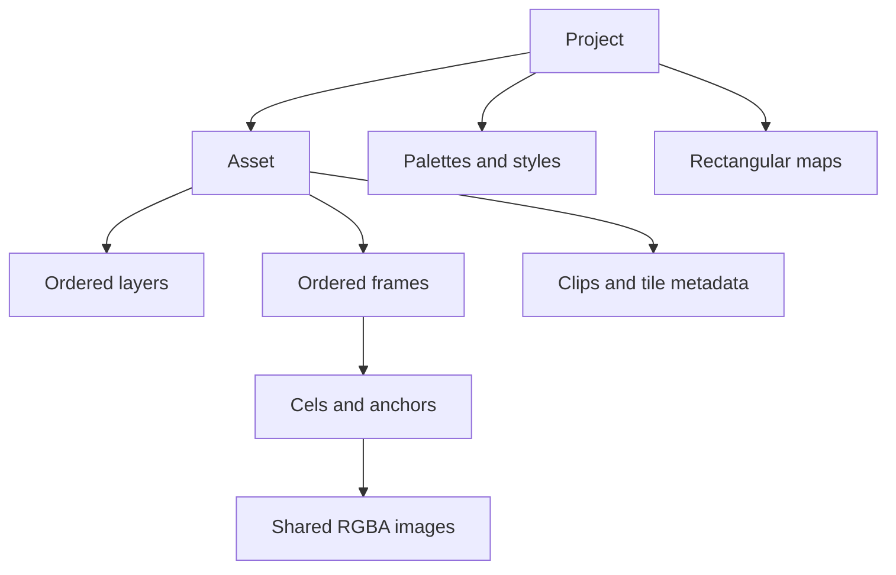

# 3. Technical domain model

Normative state contract, version 1.

## Small coherent model

| Entity | Representation and owner | Identity and relationships |
|---|---|---|
| Pixel | Four u8 channels in straight RGBA; no packed endianness-dependent integer | Alpha-zero pixels canonicalize to [0,0,0,0] |
| Image | Width/height u32 and contiguous row-major Vec<Pixel> | Shared immutable Rc<Image> behind cels; copying for mutation is explicit and budgeted |
| Palette | Ordered Vec<[u8;3]>, 1–256 unique colors | Project-level name; RGB restrictions ignore fully transparent pixels; alpha is a separate style rule |
| Asset | Fixed canvas [w,h], integer pivot, optional palette/style reference, Vec<Layer>, Vec<Frame>, ordered named clips, metadata, optional tile contract | Project-level name; sprite, icon, component and tileset share this type |
| Layer | Name, visible bool, opacity u8 | Asset-owned; vector order is back-to-front; same layer identity across frames |
| Frame | Name, duration_ms u32, BTreeMap<layer name,Cel>, BTreeMap<anchor name,[i32;2]> | Asset-owned vector establishes sheet default order; missing cel is transparent |
| Cel/component | Rc<Image> and asset-space integer offset | Address asset/layer/frame; a component is a named cel or an ordinary component asset, not another scene graph |
| Clip/animation | Name, nonempty ordered Vec<frame name>, direction string, playback forward/reverse/pingpong, repeat integer | Asset-owned; references existing frames, may intentionally repeat frames |
| Tile | Frame plus four edge labels, collision rectangles and walkable bool | A frame of an asset with tile size equal to canvas size; no separate pixel storage |
| TileMap | Dimensions in cells, tile asset reference, row-major Vec<frame name> | Project-owned name; one tile asset per map; rectangular topology only |
| Style | Optional dimensions, palette, alpha policy any/binary/opaque, required anchor names | Project-owned named technical contract, not a perceptual style model |
| Project | BTreeMap assets, palettes, styles and maps; optional export presets | No global implicit current target; all editing references are explicit |
| Operation | Finite typed enum parsed from a statement | Operates on Project; no persisted trait object, node graph or operation history |

Canvas is the asset's size, not a separate allocation. Transformation is an operation, not a second object hierarchy. A reusable weapon can be an asset whose cel is stamped into an animation; the resulting pixels remain editable independently. No live references between assets after stamping.

## IDs, ownership and coordinates

Names match `[A-Za-z][A-Za-z0-9_-]{0,63}`; case-sensitive ASCII, unique within owner. No slash in names. Cel references have exactly three segments asset/layer/frame; layer and frame references have two segments with operation-specific type. Renaming is omitted in v1: copy to a new name and delete the old object only after references are updated. Deleting a referenced frame/palette/style/asset fails; deleting a layer removes its cels, after explicit confirmation through the command's `cascade=true` field. No interactive prompt.

Image coordinates start at top-left, x right, y down. Pixel centers are `(x+1/2,y+1/2)` conceptually; all public geometry is integer. Rectangles `[x,y,w,h]` are half-open with positive sizes. Asset-space offsets may be negative. Pivots and anchors are integer grid intersections, not floating centers; [16,31] can represent a footline for a 32×32 character. Anchors must lie within the closed canvas boundary 0..w,0..h. Pixel positions use 0..w-1,0..h-1.

Drawing modifies image-local coordinates. Cel offset affects render placement only. Changing an offset does not resample or crop pixels. Raster crop adjusts cel offset by the crop origin to preserve asset placement of retained pixels. Raster mirror/quarter-turn/scale keep the cel's top-left offset; asset pivot/anchors do not move automatically. The agent must update registration metadata when that is intended. A validator reports out-of-canvas nontransparent pixels; rendering clips to the canvas by definition, while strict export refuses this condition unless the preset explicitly allows clipping.

## Invariants and limits

Default hard limits are part of v1, chosen for bounded processing, not product claims:

- Image and asset sides 1..4096; image pixels at most 16,777,216; checked multiplication before converting to usize.
- Project-wide ceilings: 100,000 structural objects (assets/layers/frames/clips/anchors/presets/maps/styles/palettes combined), 250,000 cels and 1,000,000 total frame/clip/map references; stored name/metadata string payload at most 16 MiB. Clone/import preflight counts added nodes and strings before allocation. Per-owner ceilings still apply.
- At most 4096 assets, 256 layers/asset, 4096 frames/asset, 4096 clips/asset, 64 anchors/frame, 256 palettes/styles/maps, 1,048,576 cells/map.
- Duration 1..60,000 ms; clip repeat 0..65,535 (0 means infinite playback metadata only). Frame count in clip at most 16,384, including repeated names.
- Live accounted payload at most 512 MiB: unique image allocations, detached copies, input buffers, masks, decode buffers, queued output bytes, parsed/expanded typed commands, parameter string expansions and render scratch. Expanded command/string payload additionally capped at 64 MiB. Metadata count/string limits bound additional allocator overhead; 512 MiB is not an RSS ceiling.
- One external input file at most 128 MiB; project load aggregate input at most 512 MiB; native manifest or recipe at most 8 MiB; line at most 64 KiB; quoted value at most 4096 bytes; metadata aggregate 1 MiB/project and 256 fields/object.
- Flat repeat count 1..4096; expanded statements at most 100,000; a job at most 1,000,000,000 charged work units; charge each pixel visit/candidate, parser scalar/byte, decoder input/output byte/symbol, checksum byte and structural/reference/string-copy step before running. Work exceeding the limit fails, rather than partly finishing. No recursive expansion.

All dimensions, sums, offsets, sheet indices, decoded lengths and work estimates use checked arithmetic; geometry intermediates use bounded i64 or i128. Limits can be lowered through CLI options, never raised in v1. Input-driven allocations use try_reserve where possible. Standard-library metadata allocations and OS termination can still abort on true memory exhaustion; the design does not promise recoverability from every OOM.

A cel image has exactly w*h pixels. Rc sharing is an optimization: no edit implicitly changes another cel. Frame clone copies metadata and Rc handles; first pixel edit detaches the image after budget checking. Equality and persistence depend on pixel/state content, not pointer addresses. Global armor changes use an explicit list/repeat of targets.

## Editing and state transitions

Commands never create missing asset/layer/frame owners implicitly. `cel` and `import` create or replace a cel at an existing layer/frame; replacement is explicit through `replace=true`. Creation of an existing name fails; setting an existing field is idempotent. `draw`, `stamp`, `texture` and relative movement need not be idempotent; replay a recipe on a fresh state for reproducibility.

A job loads a valid snapshot or empty project, parses and expands the complete recipe, resolves typed arguments, executes in a private working state, validates structural invariants, stages outputs, then publishes a new destination directory. Any processing error before publication discards the working state and staged output; the source snapshot is never overwritten. The library's individual operation validates its inputs before mutation; batch atomicity belongs to the job runner, not arbitrary caller sequences.

Intermediate inspection is possible by splitting a job at a snapshot boundary, or by running separate jobs for each inspection point. All preset artifacts requested within one job observe the final working state and become visible only after successful publication. There is no undo log, autosave daemon or mutable shared project process.

## Persistence decision

Use a self-contained immutable snapshot directory with `project.rai` and numbered `images/000000.rpx` surfaces. Save current state, not historical drawing scripts. This prevents an edit from depending on an external PNG that has changed or a drawing algorithm that has evolved. Recipes remain separate, reusable source instructions.

Manifest is a canonical subset of the recipe grammar: palettes, styles, assets, layers, frames, loader-only surface declarations, cels referencing those surface IDs, anchors, clips, tile/maps, metadata and export presets. It contains `snapshot version=1 semantics=1.0` after the ordinary header. Mutation commands, loops, parameters, external imports and output declarations are forbidden in snapshots. Missing/extra duplicate references fail. Unreferenced RPX files may be ignored with a warning; saving removes them in the new snapshot.

RPX layout: magic ASCII `RPX1`; width u32 little-endian; height u32 little-endian; exactly w*h*4 RGBA bytes; CRC32 (IEEE polynomial, reflected 0xEDB88320, initial/final xor 0xFFFFFFFF) little-endian of all preceding bytes. No padding, compression or trailing bytes. CRC detects accidental corruption, not malicious modification. Loader-only `surface id=S000000 file="images/000000.rpx"` declares an RPX allocation; snapshot-only `cel target=hero/body/base surface=S000000 offset=[0,0]` references it. Recipe mode rejects surface declarations and cel surface keys. All surfaces precede referring cels. Each cel points to a serialized surface ID; shared Rc surfaces are serialized once by first encounter in canonical asset-name/layer-vector/frame-vector traversal. Distinct but identical allocations may remain separate; load/save preserves sharing IDs, while semantic equality ignores sharing. Snapshot metadata excludes clocks, absolute paths and platform details.

Loaded project surface paths must be relative beneath `images/`, with no empty/dot/dotdot component, symlink or platform-reserved filename. Recipes may read external input paths explicitly; snapshot loading cannot. See [interface](06-agent-interface.md) for path and publication contracts.

Native asset transfer loads a bounded source snapshot, imports one named asset under a supplied new name and its referenced palettes/styles, and preserves cels/timing/pivots/anchors/clips/tile data. Identically named equal palette/style values are reused; unequal collisions fail E_CONFLICT. No unrelated maps, presets or project metadata are merged. Asset-scoped metadata is retained, references are retargeted, and no live cross-project link remains. Deleting a cel/clip/anchor/metadata entry is explicit; deleting a frame referenced by a clip fails. Clearing an asset palette/style reference is explicit, never a dangling name.
