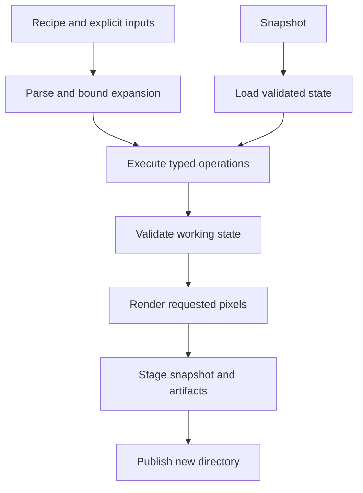

# 4. Architecture

## Concrete structure

One Cargo package with a reusable library and a thin binary. Edition 2024, minimum Rust 1.85 (a design floor, not a claim it is current); stable APIs only. No dependencies, dev-dependencies or build-dependencies; no build.rs. Both crate roots forbid unsafe code. An implementation must keep Cargo.lock free of third-party packages.

Approximately 14–20 source files are expected, split when cohesion warrants it rather than to reach a count:

| Module | Responsibility | May depend on |
|---|---|---|
| model | Images, assets, cels, clips, styles, tiles/maps; invariants and named lookup | error, limits |
| raster | Integer geometry, replace/source-over, crop/flip/quarter-turn/nearest scale | model, limits |
| ops | Typed operations; masks, palette mapping, texture and explicit edits | model, raster |
| render | Frame composition, contact/diff/onion/seam previews, grid sheet assembly | model, raster |
| codec/png + codec/inflate | Bounded PNG subset and zlib/DEFLATE decoder, deterministic writer | model, error, limits |
| codec/native + codec/palette | RPX and palette formats | model, error, limits |
| recipe | Tokenization, typed parsing, flat repeat and scalar parameter expansion; help descriptors | ops, model, error |
| project_io | Restricted manifest load/save and immutable directory staging | recipe, codec, model |
| validation | Rules returning ordered diagnostics; histograms/diff/statistics | model, render |
| json | Small output-only JSON emitter with correct escaping and integer output | std |
| job | Parse/load/execute/validate/stage/publish, work and allocation budgets | foregoing modules |
| main | OS argument/path handling, stdout/stderr and exit codes | library only |

Do not create one class/module per artistic feature. Animation is a few model types plus frame composition; tiles reuse frames and a small topology check. Palette effects are maps over pixels; shadows reuse binary masks. No event bus, ECS, trait registry, scheduler, dependency injection container, generic scene graph or render backend abstraction.

## Data flow and rendering

Each frame starts as transparent canvas. Visit layers in vector order; skip invisible layers; obtain that frame's cel; modulate source alpha with opacity; place at the integer offset; clip render coverage to canvas; source-over composite into the buffer. RGB channels stay encoded 8-bit values: blending is byte-space, not colorimetrically linear light. No gamma/profile conversion is claimed. Rendered style validation catches new colors created by partial alpha or layer opacity.

Define round(n/d) for nonnegative integers as `(n+d/2)/d` using integer division. Effective source alpha a = round(pixel_alpha * layer_opacity / 255). Let b be destination alpha, q = a*255 + b*(255-a). Output alpha = round(q/255). For each channel, output = round((source_channel*a*255 + destination_channel*b*(255-a))/q), with q=0 producing canonical transparent. Use sufficiently wide integer intermediates. This avoids repeated premultiplication rounding and is normative. Composition is ordered and not algebraically reassociated. Copy mode copies RGBA exactly, including clearing pixels.

Sheet creation uses the same renderer and stamp primitive. Export scale replicates pixels; metadata is emitted in output pixels and also records logical canvas/pivot. Contact/onion/diff previews are inspection artifacts and never overwrite source cels. Onion composites previous/current/next with documented opacities; they are not animation synthesis.

## Image import/export

### PNG is necessary and the main cost

Implement a reviewed bounded zlib/DEFLATE decoder: stored, fixed-Huffman and dynamic-Huffman blocks, overlapping LZ77 backreferences, up to 32 KiB window, CRC32 chunks and Adler32 stream. Do not attempt a compressor in the first release. The PNG writer uses filter None and stored DEFLATE blocks of at most 65,535 bytes. Files are larger but valid, deterministic and easy to audit. RGBA is default; exact indexed output is an explicit option when rendered distinct RGBA colors are at most 256.

Read legal PNG color types 0/2/3/4/6 at 8-bit and types 0/3 at 1/2/4-bit, all filters 0–4 and no-interlace/Adam7. Packed pixels use MSB-first bits and pass-local scanlines. Reject 16-bit samples with E_PNG_DEPTH; do not silently reduce precision. Decode one static image; reject APNG control chunks with E_PNG_ANIMATED rather than silently accepting only a frame. No GIF/JPEG/WebP codecs. Report recognized color-profile/gamma chunks as ignored metadata; CRC-check skipped chunks but do not inflate textual/profile payloads. Warn that color-managed appearance is outside the contract.

Validate signature, IHDR legality and order, IHDR/IEND exactly once, PLTE at most once, one or more consecutive IDAT chunks, PLTE/tRNS rules, contiguous IDAT and IEND, CRCs, deflate trees/lengths/distances, decompressed expected length, filter bytes, palette indices and checksums before committing a cel. Unknown critical chunks fail; ancillary chunks are skipped within input limits. The supported subset is not advertised as a fully conforming PNG decoder, because 16-bit/APNG support is deliberately absent. RFC1950/1951 and the W3C PNG specification are normative codec references, linked in research.

### Editable storage

Native asset transfer reuses the restricted loader and copies one asset/dependencies without a merge framework. Native manifests describe a current snapshot and RPX contains exact current surfaces. They reuse tokenization and structural declaration parsing, but execute under a restricted loader mode; snapshots cannot run an arbitrary recipe. Output-only JSON avoids writing a JSON input parser. Imports are copied into native state before save; their original paths are provenance strings, never a future load dependency.

Image caches and on-disk hash-addressed stores are unnecessary. Rc identity allows small in-memory clone reuse. Canonical serialization assigns deterministic numeric surface IDs. Native assets are not exported game files; exporting PNG loses semantic layer structure unless separate component images and JSON are explicitly requested.

## Limits, memory and runtime

Single-threaded engine for the first release. This simplifies deterministic execution and Rc ownership; independent jobs can run in separate processes. Render one frame at a time into a reusable scratch buffer. A sheet allocation plus one frame buffer is budgeted; if it cannot fit, export individual frames instead, or fail with a suggested smaller grid. No implicit streaming change in layout semantics.

Budget payload before all dimensions-driven operations, including copy-on-write detach, decoded buffers and staged output. Avoid allocating compressed output unnecessarily: stored-block PNG can stream to the staged file, with bounded IDAT chunks. CRC/Adler, parser/expansion, codec symbols and metadata clones are bounded and charged alongside pixel work. Metadata remains bounded by the domain counts and string sizes. Safe Rust prevents memory unsafety in application code; it does not remove logic errors, denial of service or all allocation-abort possibilities.

The dependency rule applies to application and Cargo dependencies. Rust std and compiler-generated platform system calls/libraries remain necessary; the application declares no FFI and invokes no subprocess. A standalone executable still uses ordinary OS libraries. Building may use the normal Rust toolchain/linker; those are not runtime dependencies. Distribute Windows x86_64-pc-windows-msvc with stable `-C target-feature=+crt-static`; measure size and validate CRT linkage on a clean Windows environment at M6; no promise of a completely static executable on every platform.

## Extending the implementation

| Extension | Normal touchpoints | Required proof |
|---|---|---|
| New drawing/effect op | ops/raster implementation, Operation variant, recipe parser/help descriptor, spec/example/tests: 3–5 production files | Pixel corpus and bounded-work estimate |
| Palette op | ops + parser/descriptor: 2–3 production files | Tie/alpha/palette invariants |
| Animation operation | model only if new persistent state; otherwise ops/render + parser: 2–4 | Timing/registration and unaffected-cel tests |
| Codec | codec module + explicit format dispatch: 2–3 | Supported-subset contract and malformed-input corpus |
| Validation rule | validation + descriptor for check name: 1–2 | Counterexample and deterministic diagnostic ordering |
| Metadata field | Prefer existing typed namespace/string metadata, no model change | Export round trip; introduce type only if operational semantics require it |
| GUI later | Consumer of the library model/execute/render/validate API | Interface work only; no engine rewrite promised for GUI-specific state |

Use a finite match and adjacent argument descriptors, not registration macros/code generation. Descriptors drive help and allowed keys; cross-field typed parsing remains explicit. A future consumer can call library functions with typed operations without the CLI or file system. The public library API is unstable before 1.0; avoid claiming semver stability for all internal types.

## Errors and determinism

One small error enum with stable code, contextual fields and repair hint. No panic for ordinary input errors. Ordered validation diagnostics sort by asset/layer/frame/check/coordinate. Directory discovery, if any, sorts filenames; no HashMap iteration in output. Input pixels canonicalize transparent RGB; no timestamps or machine paths in canonical artifacts. Hashes are not security identities.

Texture uses a specified stateless u64 mixer of seed and coordinates; bounded flat repeats use explicit iteration integers. No OS randomness, floating-point color math, trig, platform fonts or nondeterministic parallel reduction. Engine semantics version is recorded in snapshots/JSON. Byte reproducibility applies to pixels, RPX, canonical manifests and exported PNG/JSON; diagnostics containing filesystem errors may differ by OS. Reproducible binary builds are a separate future concern.

## Size-oriented build strategy

Measure standard stable profiles with opt-level `s` and `z`, thin/full LTO, codegen-units=1, strip=symbols and panic=abort for distributed CLI. Select the smallest profile that passes the correctness corpus and stays within acceptable runtime; `z` is not automatically smaller/faster. Library/tests retain normal test behavior. Do not add unsafe custom allocators, replacement std, nightly build-std, UPX or assembly.

Planning executable range is roughly 0.8–4 MiB stripped per target; Windows CRT or platform linkage can increase it beyond that. This is a low-confidence estimate, not a gate or a measured result. Record compiler version, target, profile, file size and representative elapsed times at M1/M4/M6. The suite estimate is [12,000–20,000 production Rust LOC](07-implementation-plan.md), primarily handwritten codecs, operations and a carefully bounded interface.
